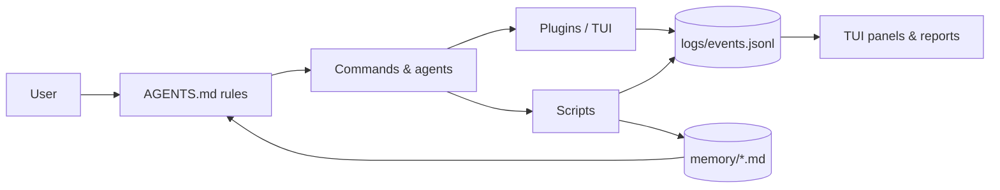

# OpenCode Agent Workspace

A small, local-first workspace for [OpenCode](https://opencode.ai): persistent memory, evidence-based handoffs, live cost tracking, a study coach, and session tagging — built as thin layers on top of the agent, not as another framework.

No vector database. No always-on service. No hidden state. Just Markdown, JSONL, a few scripts, and a handful of TUI plugins.

> This repository is a sanitized, reusable version of a personal setup. All memory content is a template or fictional example.

## Why

Long agent sessions fail in predictable ways:

- The model forgets decisions made three sessions ago.
- Context fills up, and the next session re-reads everything.
- Token spend is invisible until the bill arrives.
- "Done" is claimed without evidence.
- Search results get paraphrased and lose their sources.

This workspace addresses each problem with a small, inspectable component:

| Problem | Component |
|---|---|
| Forgetting | Markdown memory + `INDEX.md`, injected as instructions |
| Context bloat | Handoff skill + `/switch` one-key session handoff |
| Invisible cost | `stage0-log.js` + `/cost-report` + TUI token tracker |
| Unverified claims | `prove-it` skill + evidence format in `AGENTS.md` |
| Lost sources | Search playbook: write raw material to disk, pass paths |
| Ad-hoc learning | `tutor` / `capture` agents + spaced-repetition term store |
| Session sprawl | `/tag` TUI dialog + `ocs.mjs` CLI + deterministic tagged titles |
| Wrong reasoning depth | `auto-effort.js` picks `low` / `medium` / `high` per message |

## Architecture



Everything is local. The only network calls are the model provider and optional search.

### Four subsystems

1. **Memory** — layered Markdown (`preferences`, `lessons`, `projects`, `decisions`, `inbox`) with a one-line index injected into every session.
2. **Handoff & cost** — a handoff contract, a one-key `/switch`, a JSONL event log, and two ways to read cost (live footer + report).
3. **Learning coach** — `tutor` and `capture` agents, a term store with 1/3/7/14/30-day review intervals, a study panel, and capture shortcuts for macOS and Windows.
4. **Session tagging** — deterministic titles like `[math][physics] 003 entropy`, numbered per path; a CLI and a TUI dialog share the same pure functions.
5. **Adaptive reasoning** — `auto-effort.js` fills `reasoningEffort` from the model's variants based on the message, so short chats stay cheap and heavy refactors get deep reasoning.

## Quick start

Requirements:

- macOS, Linux, or Windows
- Node.js **22+** (`scripts/ocs.mjs` uses `node:sqlite`)
- OpenCode **1.19.x**
- `npm`

```bash
git clone <your-fork-url> opencode-ecosystem
cd opencode-ecosystem

# Copy config and skills into place (backs up conflicts)
./install.sh

# Or symlink for development
./install.sh --link

# Set your provider key (opencode.json reads it from the environment)
export DEEPSEEK_API_KEY="sk-..."

# Verify
opencode debug config
opencode
```

On Windows, use the PowerShell installer instead:

```powershell
powershell -ExecutionPolicy Bypass -File .\windows\install.ps1
```

See [windows/README.md](windows/README.md) for the capture hotkey and the
macOS/Windows differences.

The installer:

- copies `config/` to `~/.config/opencode/`
- copies `skills/` to `~/.agents/skills/`
- copies `memory.template/` to `~/.config/opencode/memory/` **only if memory does not already exist**
- never overwrites an existing memory directory
- runs `npm install` inside `~/.config/opencode` for the TUI plugin dependency

To use a different provider, edit `config/opencode.json` and keep the key in an environment variable:

```json
"options": { "apiKey": "{env:YOUR_PROVIDER_KEY}" }
```

Optional: the search plugin uses [Tavily](https://tavily.com). Authenticate with `tvly login`, or set `TAVILY_API_KEY`.

## Session tagging (`/tag`)

Open a **main** session in the TUI and type `/tag`. Pick an existing path or create a new one; the title is rewritten deterministically:

```
[math][physics] 003 entropy
```

- The TUI command is registered by `config/plugins/tagger.tsx`; it is not a Markdown command under `config/command/`.
- The CLI shares the same logic: `node ~/.config/opencode/scripts/ocs.mjs ls`.
- Pure functions and tests live in `config/scripts/tag-core.mjs` and `config/scripts/tag-core.test.mjs`.
- Your actual session tags are not part of this repository; only the system and templates are.
- Full details: [docs/tagging.md](docs/tagging.md).

## Repository layout

```
config/                 -> ~/.config/opencode/
  AGENTS.md             global rules (language, quality, search, memory)
  opencode.json         provider, model, plugins, instructions
  tui.json              TUI plugins and panels
  handoff.json          prices, thresholds, guards, output limits
  agent/                tutor, capture
  command/              /next /done /stuck /status /switch /term ...
  plugins/              event log, token tracker, study panel, tagger, auto-effort
  scripts/              term, panel, cost report, session tagging
skills/                 -> ~/.agents/skills/
  architect/ grill/ handoff/ memory/ prove-it/
memory.template/        copied once to ~/.config/opencode/memory/
macos/                  Automator quick action for capture
windows/                install.ps1, capture scripts, Windows notes
docs/                   design notes (Chinese)
examples/               fictional walkthrough and sample memory
```

## Design principles

- **Local-first.** Memory is Markdown you can read, diff, and edit. Logs are JSONL.
- **Thin layers.** Prefer mature plugins; write only the missing glue.
- **Evidence over claims.** "Done" means a command output, a test count, or a screenshot.
- **Staged rollout.** Record first, automate later. Every layer can be removed independently.
- **Privacy by default.** No secrets in the repo; personal memory is never installed over.
- **Small machines count.** No local models, no vector DB, no resident services.

## Documentation

Design notes are in Chinese, with English code and README:

- [Architecture](docs/architecture.md)
- [Agent rules](docs/agent-rules.md)
- [Search playbook](docs/search-playbook.md)
- [Memory](docs/memory.md)
- [Handoff](docs/handoff.md)
- [Learning coach](docs/learning.md)
- [Cost and tokens](docs/cost-and-tokens.md)
- [Session tagging](docs/tagging.md)
- [Adaptive reasoning](docs/reasoning-effort.md)
- [Windows](windows/README.md)
- [Privacy and sanitization](docs/privacy.md)
- [Case study: decisions and tradeoffs](docs/case-study.md)

## Screenshots

_Add TUI screenshots here: sidebar token tracker, study panel, tagger dialog._

## License

MIT for this repository's own code and docs. Third-party skills and dependencies keep their original licenses; see [THIRD-PARTY-NOTICES.md](THIRD-PARTY-NOTICES.md).
